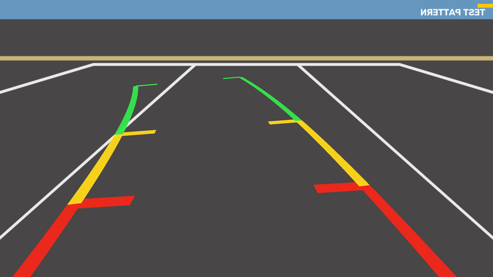

# Rear-View Camera

A backup-camera display in C++ and OpenGL: a live camera feed rendered through GLSL shaders, with
dynamic parking guidelines that bend with the steering angle, the way a car's reversing camera
does on the infotainment screen.



## What it does

- Captures frames from a webcam (or a video file, or a synthetic test pattern) on a background
  thread, keeping only the newest frame so the display never lags behind the camera.
- Uploads each new frame into an OpenGL texture and draws it as a fullscreen quad. The BGR to RGB
  conversion and the mirror flip happen in the shaders, not on the CPU.
- Builds the guidelines as 3D geometry on the ground plane from a kinematic bicycle model of the
  car, then projects them through a virtual pinhole camera that matches the real one (mounting
  height, pitch, field of view). Perspective comes out right for free.
- Colours the path by distance (red within 1 m, yellow to 2 m, green to 4 m) with tick marks at
  each boundary.
- Reports capture fps, render fps, CPU frame time, and capture-to-present latency in the title bar.

## Build and run (macOS, Apple Silicon or Intel)

```bash
brew install cmake glfw glm opencv
cmake -B build && cmake --build build -j
./build/rearcam            # webcam 0
./build/rearcam --test     # no camera needed
./build/rearcam --video clip.mp4
```

On first run macOS asks for camera access for your terminal. If it is denied, the app falls back to
the test pattern; re-enable it under System Settings > Privacy & Security > Camera.

| Key | Action |
| --- | --- |
| Left / Right | steer (hold) |
| C | centre the wheel |
| Up / Down | camera pitch |
| M | mirror on/off |
| G | guidelines on/off |
| S | save `rearcam_screenshot.png` |
| Q / Esc | quit |

## Layout

```
src/main.cpp        argument parsing
src/app.cpp         window, GL state, render loop, input
src/camera.cpp      threaded capture with a latest-frame mailbox
src/guidelines.cpp  steering geometry -> ground-plane triangles
src/camera_model.h  the pinhole camera (pose + lens) shared by overlay and test pattern
src/gl_utils.cpp    RAII wrappers for shaders and textures
shaders/            video.vert/frag (camera quad), guides.vert/frag (overlay)
docs/NOTES.md       how it works, step by step
```

## OpenGL on macOS

Apple ships OpenGL up to 4.1 core profile (implemented on top of Metal) and has marked it
deprecated since macOS 10.14. It still works on Apple Silicon. The build defines
`GL_SILENCE_DEPRECATION` to hide the warnings. The shaders target GLSL 3.30, which maps directly onto
OpenGL ES 3.0, the API embedded and automotive GPUs expose.

## Roadmap

- [ ] Fisheye undistortion in the fragment shader (real backup cameras are 180 degree lenses)
- [ ] Bird's-eye (top-down) view with a homography, the building block of a 360 surround view
- [ ] Pixel buffer objects for asynchronous texture upload, measured against the current path
- [ ] OpenGL ES 3.0 build on a Raspberry Pi with V4L2 capture
